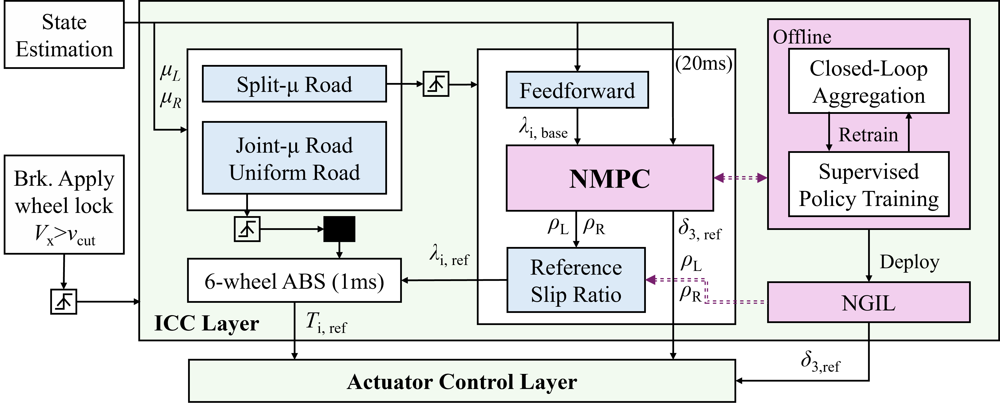
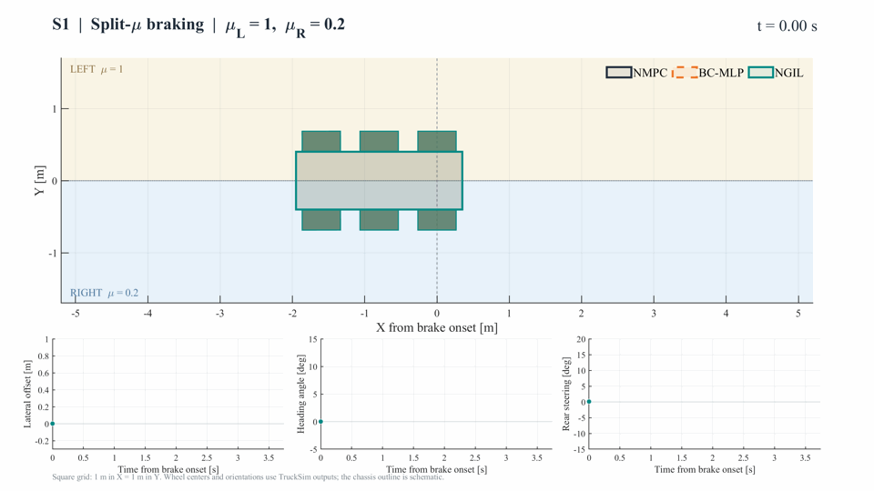
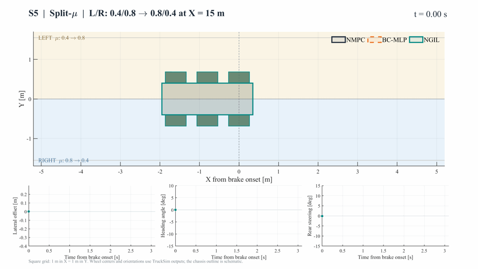
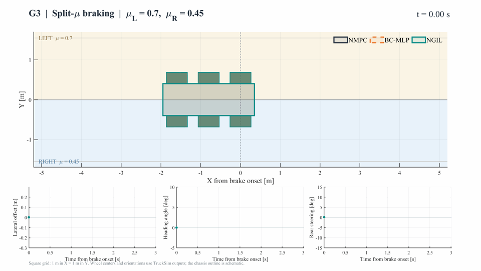
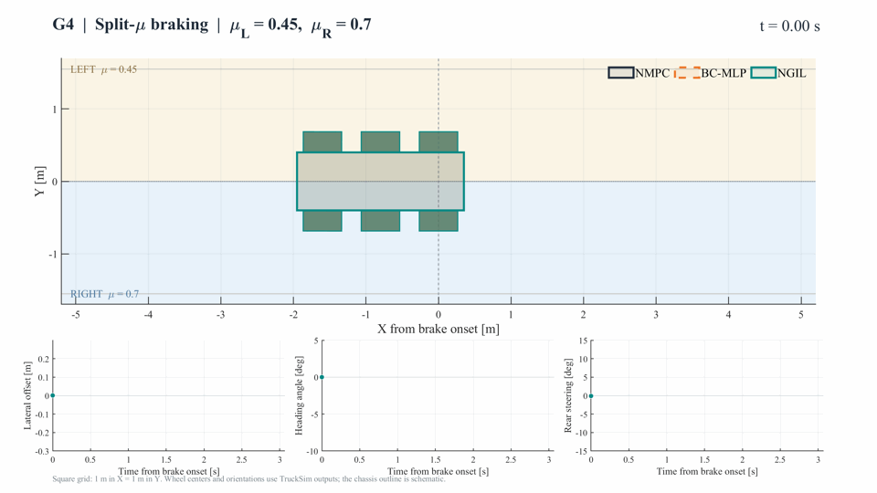
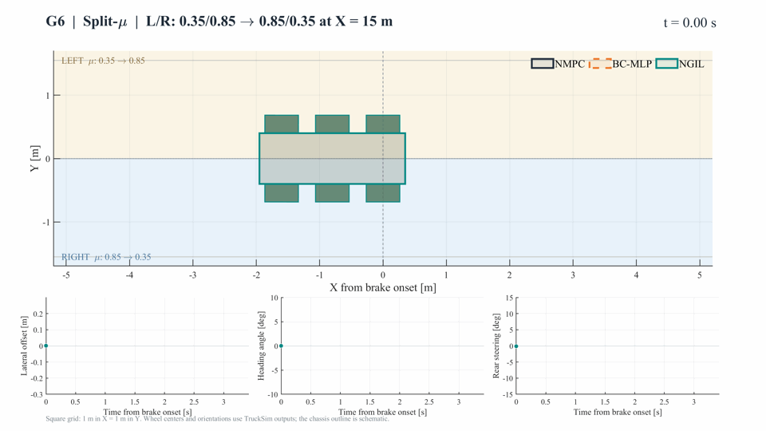
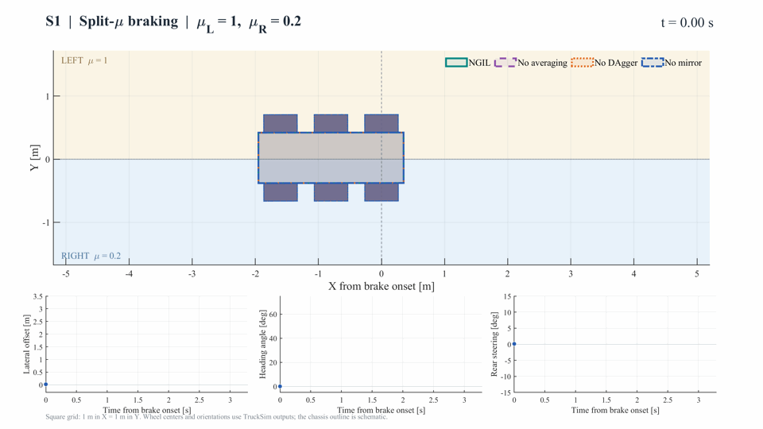
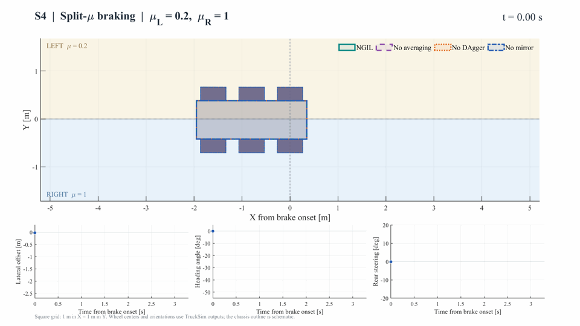
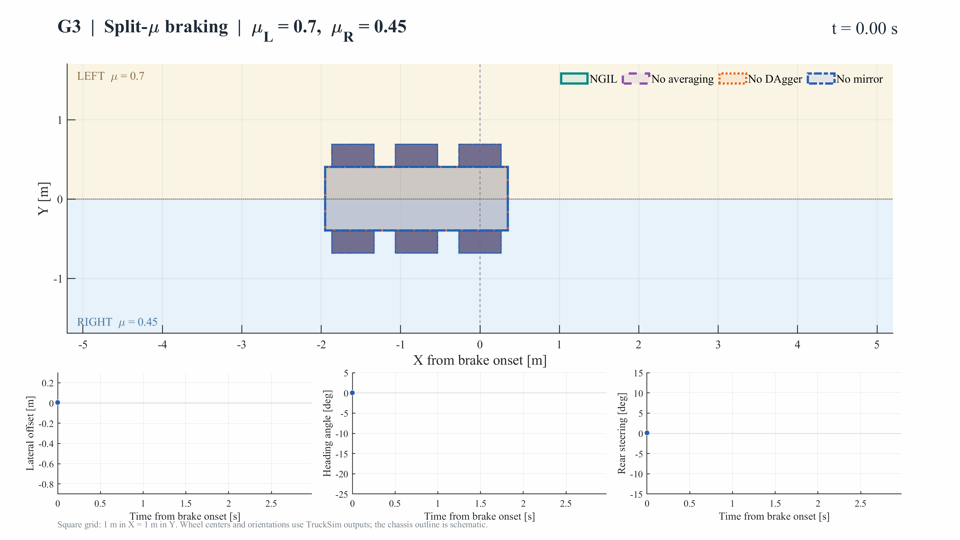
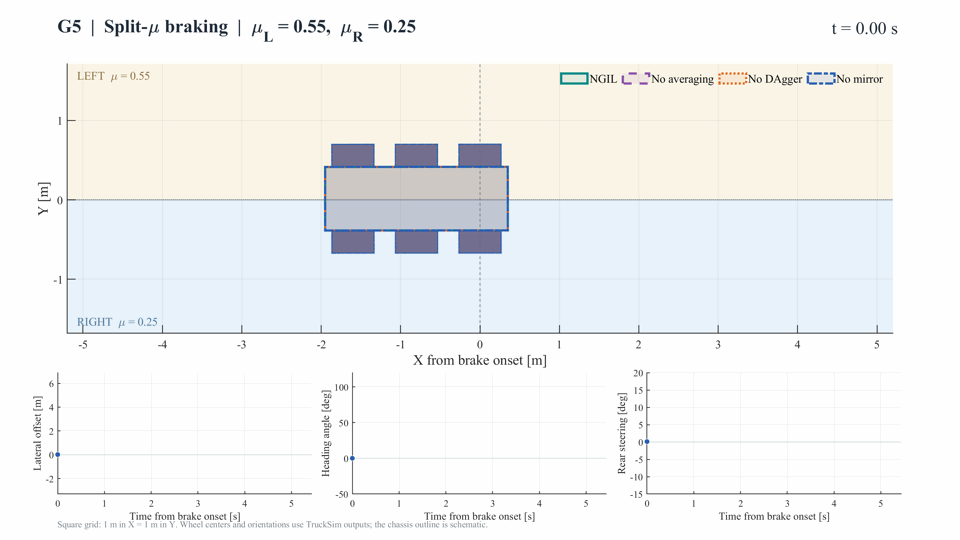

# NMPC-Guided Imitation Learning for RWS-Assisted ABS on Split-μ Roads

**Authors:** Ruiqi Fang, Weichao Zhuang, Jinhao Liang, Luca Dimauro, Alessandro Vigliani, Zhaoyu Qiu, Guodong Yin, and Aldo Sorniotti  
**Corresponding author:** Guodong Yin

## Overview

This work studies emergency braking of a three-axle, six-wheel vehicle on split-μ roads. Asymmetric tire–road friction creates a yaw moment, while rear-wheel steering (RWS) can help maintain directional stability. The controller coordinates braking and RWS at the reference level: it adjusts the left and right wheel-slip references and the rear-steering reference, while a six-wheel anti-lock braking system (ABS) continues to regulate individual brake torques.

An NMPC expert accounts for combined tire slip and vehicle dynamics. Its coordination policy is transferred to a lightweight neural controller through expert demonstrations and closed-loop data aggregation. The intent is to avoid solving a nonlinear optimization problem during every online control update while retaining the expert's useful coordination behavior.

## Main ideas

- **Reference-level coordination:** the learned policy commands left/right slip-reference release and rear-steering reference, rather than replacing the wheel-level ABS.
- **Physics-informed expert:** NMPC generates coordinated actions using a six-wheel vehicle model with combined-slip tire forces.
- **Learning under closed-loop state shift:** training uses expert demonstrations and additional expert labels on states reached by the learned controller.
- **Ablation analysis:** the animations below compare NGIL with variants that remove member averaging, closed-loop data aggregation, or mirror-based training.

## Control framework

## Public preview files

This pre-publication repository contains the framework figure, qualitative animations, a [signal-interface overview](docs/interface.md), and a small MATLAB [synthetic-data example](examples/generate_synthetic_data.m). The example demonstrates a CSV layout and generic plotting and metric calculations; its values are fabricated and are **not** the vehicle simulations reported in the paper.

In MATLAB, run `examples/generate_synthetic_data`, then `examples/plot_synthetic_data`. The supplied `examples/synthetic_episode.csv` can be inspected without MATLAB. On Windows, check the release contents before committing with `powershell -NoProfile -ExecutionPolicy Bypass -File tools/audit_release.ps1` from the repository root.

## Main comparison animations

Each animation shows the vehicle paths and six-wheel poses for NMPC, BC-MLP, and NGIL in one coordinate system. The lower panels show lateral offset, heading angle, and rear-steering angle.

### S1

### S2

### S3

### S4

### S5

### G1

### G2

### G3

### G4

### G5

### G6

## Ablation animations

Each animation compares four vehicles: NGIL, no member averaging, no DAgger-style closed-loop data aggregation, and no mirror-based training. The same vehicle scale, road coloring, and plot layout are used as in the main animations.

### S1

### S2

### S3

### S4

### S5

### G1

### G2

### G3

### G4

### G5

### G6

## Code availability

The NMPC solver, combined-slip vehicle model, controller implementation, learning and inference code, trained weights, calibration parameters, raw trajectories, and TruckSim model are not included in this pre-publication release. The files here cannot reproduce the paper's closed-loop results. Further code and data release will be reviewed after publication.
